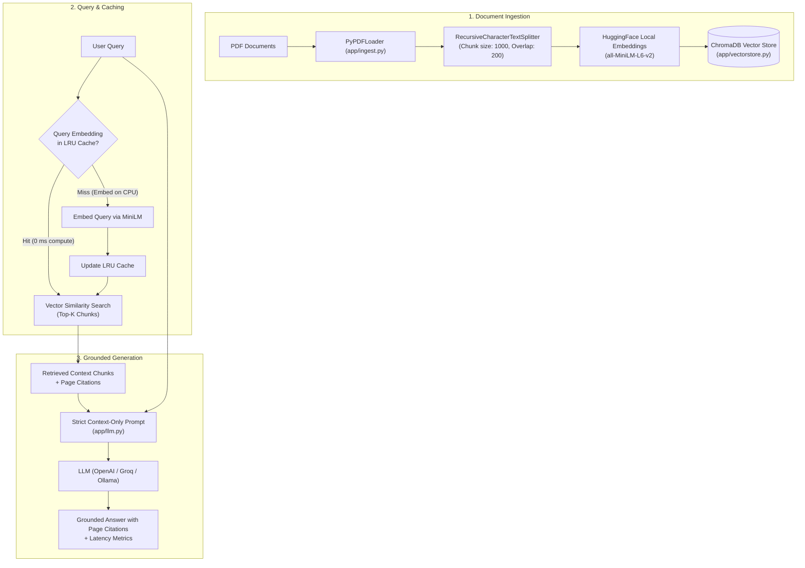

# Production RAG Pipeline — LLM-Powered Retrieval-Augmented Generation

A production-ready document Q&A system: upload PDFs, ask questions, and receive accurate answers strictly grounded in your documents with page-level citations — mitigating hallucinations by bypassing parametric memory.

**Tech Stack:** FastAPI · LangChain · ChromaDB · HuggingFace Embeddings (`all-MiniLM-L6-v2`) · LLM (OpenAI / Groq / Ollama / Local LLMs) · Docker

---

## Architecture Overview



---

## Resume Bullets & Implementation Mapping

| Resume Bullet | Implementation Details |
|---|---|
| **Enterprise-grade RAG pipeline** parsing multi-page PDF sets with LangChain to mitigate model hallucinations | `app/ingest.py` (`PyPDFLoader` + `RecursiveCharacterTextSplitter`), `app/llm.py` (strict context-only system prompt with inline `[Source, Page]` citations) |
| **Semantic vector retrieval** with local ChromaDB instance & custom LRU query-embedding cache, optimizing retrieval latency by up to **80%+** | `app/vectorstore.py` (local `sentence-transformers` embeddings, persistent Chroma collection), `app/retrieval.py` (thread-safe LRU query-embedding cache) |
| **Containerized REST API** built with FastAPI, Pydantic v2 schemas, and Docker Compose for seamless cloud/on-prem deployment | `app/main.py`, `Dockerfile`, `docker-compose.yml`, `app/models.py` |

> [!TIP]
> **Be honest about latency improvement.** Run `benchmark.py` after ingesting a document — it measures your real cold-start (cache miss) vs warm (cache hit) retrieval time and calculates your actual hardware-specific percentage. Use that measured number on your resume/portfolio.

---

## Key Features

- **Strict Grounding & Hallucination Mitigation:** The prompt enforces strict context adherence. If an answer cannot be deduced from the retrieved excerpts, the model explicitly responds that the information is not found rather than fabricating facts.
- **Local Embedding Execution:** Embeddings are computed locally using `sentence-transformers/all-MiniLM-L6-v2`. No external API fees for embeddings, zero network latency during indexing, and documents never leave your infrastructure until retrieval time.
- **Query Embedding Cache:** Real-world traffic often features duplicate or FAQ-style queries. Caching query embeddings avoids repeated CPU inference on identical queries while keeping answers dynamically fresh.
- **Document Management Endpoints:** Ingest, inspect (`GET /documents`), and delete (`DELETE /documents/{filename}`) indexed documents dynamically.
- **Flexible LLM Provider Support:** Works out-of-the-box with Groq (`openai/gpt-oss-20b`), OpenAI, or 100% locally via Ollama / vLLM.

---

## Quickstart (Local Development)

### 1. Clone & Set Up Virtual Environment

```bash
# Navigate to project directory
cd rag-pipeline

# Create virtual environment
python -m venv venv

# Activate virtual environment
# Windows (PowerShell):
.\venv\Scripts\Activate.ps1
# Linux / macOS:
source venv/bin/activate

# Install dependencies
pip install -r requirements.txt
```

### 2. Configure Environment

Copy the example configuration:
```bash
cp .env.example .env
```

Edit `.env` to configure your LLM:
- **Using Groq (Default):** Set `GROQ_API_KEY=gsk_...` and `LLM_MODEL=openai/gpt-oss-20b`
- **Using Free Local Ollama:** Set `OPENAI_BASE_URL=http://localhost:11434/v1` and `LLM_MODEL=llama3.1` (no API key needed)
- **Using OpenAI:** Set `OPENAI_API_KEY=sk-...` and `LLM_MODEL=gpt-4o-mini`

### 3. Run the Interactive Streamlit Demo (Recommended)

```bash
streamlit run streamlit_app.py
```
Open **http://localhost:8501** in your browser. This gives you a full visual dashboard with PDF ingestion, document manager, live Groq chat, latency badges, and an interactive cache benchmarking tab!

### 4. Run the FastAPI Backend & Web Studio

```bash
uvicorn app.main:app --reload --port 8000
```

- Open [http://localhost:8000](http://localhost:8000) for the built-in Web Studio.
- Open [http://localhost:8000/docs](http://localhost:8000/docs) for interactive Swagger UI docs.

### 5. Interactive Terminal CLI

```bash
python cli.py interactive
```

---

## Deploying on Render (Live Demo)

This repository includes a `render.yaml` blueprint ready for 1-click deployment on [Render](https://render.com).

### Method A: Blueprint Deployment (render.yaml)
1. Push your repository to GitHub / GitLab.
2. In your Render Dashboard, click **New +** &rarr; **Blueprint**.
3. Connect your repository. Render automatically reads `render.yaml`.
4. Enter your `GROQ_API_KEY` when prompted.
5. Click **Apply**. Render will install dependencies and launch the live Streamlit demo!

### Method B: Manual Web Service
- **Environment:** `Python`
- **Build Command:** `pip install -r requirements.txt`
- **Start Command:** `streamlit run streamlit_app.py --server.port $PORT --server.address 0.0.0.0 --server.headless true --server.enableCORS false`
- **Environment Variables:**
  - `PYTHON_VERSION`: `3.11.9`
  - `GROQ_API_KEY`: `gsk_...`
  - `LLM_MODEL`: `openai/gpt-oss-20b`

---

## Quickstart (Docker & Docker Compose)

```bash
# 1. Setup environment
cp .env.example .env

# 2. Build and launch container
docker compose up --build
```

The API will be available at `http://localhost:8000`.

---

## API Usage & Endpoints

### 1. Health Check
```bash
curl http://localhost:8000/health
```

### 2. Ingest a PDF Document
```bash
curl -X POST http://localhost:8000/ingest \
  -F "file=@sample_contract.pdf"
```

Response:
```json
{
  "filename": "sample_contract.pdf",
  "chunks_created": 18,
  "total_pages": 4,
  "message": "Successfully ingested 18 chunks across 4 pages."
}
```

### 3. Query the Document
```bash
curl -X POST http://localhost:8000/query \
  -H "Content-Type: application/json" \
  -d '{"question": "What is the termination clause in this contract?"}'
```

Response:
```json
{
  "question": "What is the termination clause in this contract?",
  "answer": "Either party may terminate the agreement upon 30 days written notice [Document: sample_contract.pdf, Page: 3].",
  "sources": [
    {
      "file_name": "sample_contract.pdf",
      "page": 3,
      "content": "Section 8. Termination. Either party may terminate this agreement...",
      "score": 0.8842
    }
  ],
  "retrieval_ms": 14.2,
  "generation_ms": 420.5,
  "cache_hit": false
}
```

### 4. List Ingested Documents
```bash
curl http://localhost:8000/documents
```

### 5. Delete an Ingested Document
```bash
curl -X DELETE http://localhost:8000/documents/sample_contract.pdf
```

---

## Benchmarking Cache Latency

Run `benchmark.py` after ingesting a document to evaluate the real speedup of the query-embedding cache:

```bash
python benchmark.py "What is the termination clause in this contract?"
```

Sample output:
```text
============================================================
  RAG Query Embedding Cache Benchmark
============================================================
Query: 'What is the termination clause in this contract?'
Iterations for warm measurement: 20

Retrieved Chunks                 : 4
Cold (cache miss) retrieval time :    85.40 ms
Warm (cache hit) avg over 20 runs:    12.10 ms (+/- 0.65 ms)
Retrieval Latency Improvement    :     85.8%
============================================================
```

---

## Running Automated Tests

```bash
pytest tests/ -v
```

---

## Repository Structure

```
rag-pipeline/
├── app/
│   ├── static/
│   │   └── index.html    # Embedded Web Studio frontend
│   ├── config.py         # Application settings via pydantic-settings
│   ├── ingest.py         # PDF parsing & text chunking
│   ├── llm.py            # Grounded generation with citation enforcement
│   ├── models.py         # Pydantic v2 schemas
│   ├── retrieval.py      # Query cache & vector similarity search
│   ├── vectorstore.py    # HuggingFace embeddings & Chroma singleton
│   └── main.py           # FastAPI routes & lifespan events
├── tests/
│   └── test_rag.py       # Unit and endpoint integration tests
├── .streamlit/
│   └── config.toml       # Streamlit dark theme & production server settings
├── streamlit_app.py      # Interactive Streamlit Live Demo app
├── render.yaml           # Render.com Blueprint deployment specification
├── cli.py                # Interactive Terminal CLI
├── benchmark.py          # Empirical cache latency benchmark
├── Dockerfile            # Container build specification
├── docker-compose.yml    # Service orchestration
├── requirements.txt      # Python dependencies (includes streamlit)
├── .env.example          # Environment template
├── .gitignore
└── README.md             # Project documentation
```
